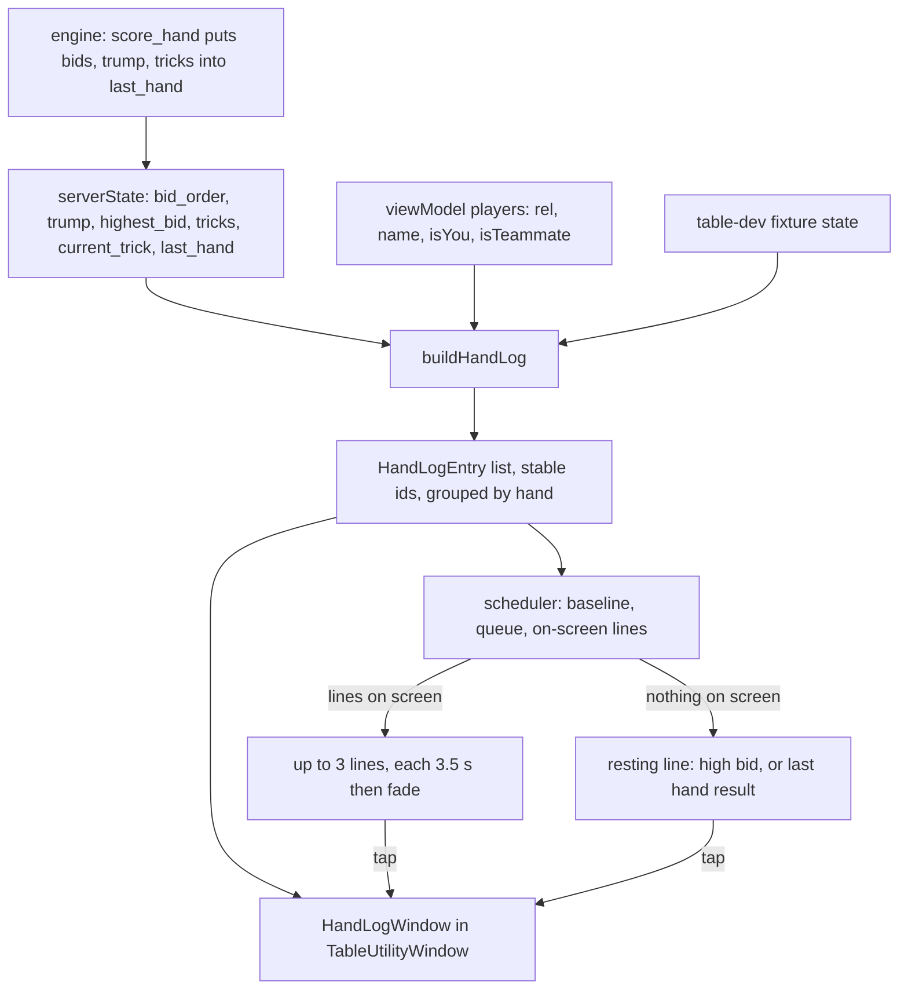

# Table Action Ticker and Hand Log - Plan

**Target repos:** pidro-frontend (most paths, relative to its root) and pidro-backend (U0, paths prefixed `pidro_backend/`). Ticket: PID-221 (also closes the open part of PID-214).

## Goal Capsule

- **Objective:** A player at the table, on any phone size, can always see what just happened (who bid, who played what, who took the trick and for how much) and can read back the whole current or just-finished hand on demand.
- **Means:** A pure hand-log builder over server state feeds a paced, fading ticker in place of the plaque's bid line, plus a hand-log window opened by tapping it (KTD1, KTD2). The server adds the finished hand's bids, trump and tricks to `last_hand` (KTD6).
- **Authority:** The user's settled decisions (Key Decisions) > this plan's Requirements > KTDs > unit Approach.
- **Stop conditions:** Stop and report if server state, including U0's addition, still lacks something a requirement needs, so that showing it would mean the client computing rules (R9).
- **Execution profile:** Mobile package, one additive field in the shared store, one additive field set in the backend `last_hand`. Two PRs: backend (U0) and frontend (U1–U5). The client tolerates an older server, so they can merge in either order.
- **Finishes and ships:** `lfg` pipeline. Open PRs, CI decided, backend deploy and Beta update left to the user.

---

## Product Contract

### Summary

The single "Eli bid 6" pill under the score plaque becomes a short feed of the latest table actions, paced so each line stays readable. The feed settles on a resting line: the current high bid during a hand, the hand's result between hands. Tapping the feed opens a log of the hand: every bid in order, trump, each trick with its plays, taker and points, and the result.

### Problem Frame

On small phones (360×640) and for seniors with poor eyesight, the per-seat status lines under each name are the only trace of what happened, and each one is overwritten when that seat acts again. An Android tester reported that a bot's bid amount shows without who bid it (PID-214). Marcel proposed turning the plaque's bid line into a feed, with a log behind it. Today the hand's final trick never reaches the client at all: the engine scores and resets in the same step it finishes that trick, so even the existing table signals never show who took the last trick.

### Key Decisions

- One tap plays a card; the ticker never adds a confirm step or a drag. (session-settled: user-directed — chosen over drag or confirm-before-play: Marcel loves one-tap and seniors are a core audience.) Governs R10.
- Played-card history piles stay on the table. (session-settled: user-directed — chosen over removing the piles: Classic shows them.) Governs R10.
- No "N on the table" count text anywhere in the ticker or log. (session-settled: user-directed — chosen over a count label: Marcel rejected it.) Governs R8.
- Dumb client: every line comes from server state and its transitions; the client never works out card values, trick winners or points. (session-settled: user-directed — chosen over client-side rules logic: the server is the single source of truth.) Governs R9, R12.
- Memory aids (count meter, last-trick recall) stay out; they belong to PID-220's "Help me keep count" setting. (session-settled: user-directed — chosen over putting them in the ticker: Marcel's call.) Governs R8.

### Requirements

**Ticker**

- R1. The ticker sits where the bid line sits today (under the plaque in portrait, beside it in landscape) and shows at most three lines at once, newest last, without moving the plaque.
- R2. Actions shown: a seat's bid or pass, trump declared, each card played, each trick taken with the server's points for it, the 2 of trump's point, and the hand result. This includes the hand's final trick.
- R3. Each line stays fully readable for at least about 3 s before it fades. When actions arrive faster than that, later lines wait their turn; none is cut short. Actions already present when the table first gets state (reconnect, late join) are not replayed.
- R4. When no line is showing, the ticker shows a resting line: the current high bid and its holder ("Nora bid 7") from the first bid to the end of the hand, and the last hand's result ("We made it +9") between hands. Before the first bid with no last hand, it shows nothing.
- R5. Names read as on the seats, "You" for the viewer. Teams read "We"/"They" from the viewer's side, "N/S"/"E/W" for spectators. Your team's lines use the gold tone the bid line uses today. A long name truncates; the card, amount or points never do.
- R13. The ticker looks tappable (a trailing chevron, as the plaque has) and is a separate touch target from the plaque, which keeps opening "Recent scores".

**Hand log**

- R6. Tapping the ticker opens a hand-log window: bids in the order made, trump, each finished trick (its plays in order, fewer than four once a seat has gone cold, who took it, its points, any 2-of-trump point), the trick in progress, and the result once scored.
- R7. Between hands, while the server still sends the last hand, the log shows that whole hand (bids, trump, tricks, result) above the new hand's entries.
- R14. The log opens scrolled to the newest entry and updates live while open. It closes itself when it becomes your turn to bid or play.

**Constraints**

- R8. Neither the ticker nor the log shows running point totals, cards remaining, or "N on the table" counts.
- R9. Every winner, point value and result shown is read from server fields (`tricks[].winner/points/two_of_trump`, `last_hand`, `highest_bid`, ordered `bids`). Live `hand_points` is never used.
- R10. The ticker never blocks table input: it does not cover the hand, the trick, or seat avatars, and card play stays one tap.
- R11. Works in portrait and landscape at 360×640, on large phones and on iPad. Ticker text scales with large text up to 1.3× (as the bid line does today); the log scales freely. Reduced motion gets a fade only, with no slide. With a screen reader on, each new line is announced once.
- R12. The server includes the finished hand's bids, trump and tricks in `last_hand`, so the client never reconstructs them.

### Acceptance Examples

- AE1. **Covers R1, R3.** Given a hand in play, Kai (North) plays K♠ and then Nora (West) plays 5♠. The ticker shows "Kai plays K♠" and "Nora plays 5♠", and each fades about 3 s after it appeared.
- AE2. **Covers R2, R9.** Given the server finishes a trick with `winner: east`, `points: 5`, and `two_of_trump: {position: south, points: 1}` for a viewer at South, the ticker adds "They took it +5" and "Your 2 +1".
- AE3. **Covers R3.** Given a player reconnects mid-hand with three finished tricks, the ticker shows only the resting bid line until the next action arrives. The log still lists all three tricks.
- AE4. **Covers R4.** Given bidding with Nora at 7 and nothing new for 4 s, the ticker reads "Nora bid 7".
- AE5. **Covers R2, R7, R12.** Given the last card of hand 3 is played, the next snapshot has hand 4, empty `tricks`, and a `last_hand` carrying hand 3's tricks. The ticker shows the final trick's last play, its taker line and the result, in turn. The log shows all of hand 3 above hand 4's bids.
- AE6. **Covers R3.** Given two plays shown at t=0 and t=1.5 s, when three entries arrive at t=2 s, no line leaves before it is 3 s old, and the three new lines show as older ones fade.

### Scope Boundaries

- No center-of-table bid callout. PID-214 asked for one, but the ticker carries "who bid what" in a fixed place instead of a second, competing announcement. Revisit if testers still miss bids.
- The existing "+N" trick pop (`TableSignals`) is not extended to the final trick in this work, although U0 makes that possible.
- Considered and not built: persisting the log across app restarts. The log is rebuilt from server state on every snapshot, so a reconnect already restores it. Only line pacing is local.
- Considered and not built: a log for hands before the last one. The server keeps only `last_hand`, and older hands are a separate feature.

#### Deferred to Follow-Up Work

- The compact tiny-phone table mode (horizontal nameplates, smaller plaque) is the next piece of work and may move the ticker's anchor.

---

## Planning Contract

### Key Technical Decisions

- KTD1. **One pure builder turns a state snapshot into the ordered hand log.** `buildHandLog` takes the ordered bids, trump, bid holder, finished tricks, current trick plays, `last_hand`, hand number, and the seats (relative position, name, isYou/isTeammate). It returns entries with stable ids (`bid-<hand>-<pos>`, `play-<hand>-<trick>-<i>`, `trick-<hand>-<n>`, `two-<hand>-<n>`, `result-<hand>`) grouped by hand. The log can be rebuilt from any snapshot, so reconnects need no history, and the builder is unit-testable like `buildTableModel`. Governs R2, R6, R7, R9.
- KTD2. **Line pacing is the only local state.** A pure scheduler keeps a baseline of ids already seen, a queue of new ids, and the lines on screen with their show times. The baseline is taken from the first non-empty snapshot (and again when the room code changes), not the first render, because the table mounts before server state arrives. A line shows for 3.5 s, fades for 400 ms, and only then frees its slot. Queued lines fill free slots in order, and at most three are on screen. If the queue backs up past six, the oldest queued lines are dropped (the log still has them). The resting line appears only when no line is on screen or fading. Governs R1, R3, R4.
- KTD3. **Keep the server's bid order in the shared store.** `setServerState` folds the server's ordered `bids` list into a position record, which loses the order. Add an additive `bid_order` array (`{position, amount}` in server order) next to the record; existing consumers keep `bids`. The engine appends bids (`state.bids ++ [bid]`) and tricks (`state.tricks ++ [trick]`), so array order is play order. When `bid_order` is absent, the log shows no bid entries rather than a guessed order. Governs R6.
- KTD4. **The log window reuses `TableUtilityWindow`.** "Recent scores" already uses it; one window shape for table utilities keeps the DS rule. The ticker gets its own pressable whose hit area extends sideways and downward only, never up into the plaque. Governs R13, R14.
- KTD5. **The dev fixture feeds the same builder.** `GameCanvasDev` renders `Scoreboard` from a mock model, not from `serverState`. It builds `buildHandLog` input from its fixture tricks, current trick, a fixture bid list and its `lastHand`, so `/table-dev` shows the real ticker and log.
- KTD6. **The server carries the finished hand in `last_hand`.** `Scorer.score_hand` adds `bids`, `trump` and `tricks` from the state it is scoring, before the hand-complete reset clears them. The serializer passes them through the existing `serialize_bid` / `serialize_trick` / card serialization so the shapes match the live fields. The field is additive. A client on an older server shows the final trick as missing and the last hand as result-only. Governs R2, R7, R12.

### High-Level Technical Design

### Assumptions

- Feed wording: "Eli bid 6", "Eli passed", "Trump ♠", "Nora plays 5♠", "We took it +6" / "They took it" (no "+0"), "Our 2 +1" / "Their 2 +1" ("Your 2 +1" when the viewer played it), "We made it +9" / "They were set". Short enough for the 168 pt pill at 360 wide.
- The log window is an overlay through `TableUtilityWindow`, not a bottom sheet, following the existing pattern.
- The ticker takes over the bid part of PID-214's centered-callout idea (see Scope Boundaries). Seat status lines ("Bid 7", "Passed") stay as they are.
- The hand-result line appears in the ticker as well as in the existing `HandResult` card. The card is the moment; the ticker line is the trace.

### Sequencing

U0 can run in parallel with U1–U5. U1 → U2 → U3 → U4 → U5 on the frontend; U3 and U4 can share a commit.

---

## Implementation Units

### U0. Server keeps the finished hand in `last_hand`

- **Goal:** `last_hand` carries the hand's bids, trump and tricks, including the final trick.
- **Requirements:** R2, R7, R12; KTD6.
- **Dependencies:** none.
- **Files:** `pidro_backend/apps/pidro_engine/lib/pidro/finnish/scorer.ex`, `pidro_backend/apps/pidro_server/lib/pidro_server_web/serializers/game_state_serializer.ex`, `pidro_backend/apps/pidro_server/lib/pidro_server_web/schemas/room_schemas.ex` (`LastHand`), `pidro_backend/apps/pidro_server/test/pidro_server_web/serializers/game_state_serializer_test.exs`, `pidro_backend/apps/pidro_engine/test/unit/game/engine_transition_test.exs`.
- **Approach:**
  1. In `score_hand`, add `bids: state.bids`, `trump: state.trump_suit`, `tricks: state.tricks` to the `last_hand` map.
  2. In the serializer, replace the raw `last_hand` pass-through with a function that serializes those three keys with the existing helpers and leaves the rest as is.
  3. Extend the `LastHand` OpenAPI schema with `bids`, `trump` and `tricks`, reusing the existing bid and trick schemas.
  4. Add the three fields to the frontend `ServerLastHand` type in U1.
- **Patterns to follow:** `serialize_tricks` / `serialize_bids` in the same serializer; PID-218's addition of `last_hand` (backend PR 89).
- **Test scenarios:**
  - After the last card of a hand, the post-transition state has `hand_number` + 1, empty `tricks`, and `last_hand.tricks` with every trick of the finished hand, the last one with its winner, points and `two_of_trump`.
  - A trick where a seat went cold appears in `last_hand.tricks` with fewer than four plays.
  - The serialized `last_hand.tricks` cards and bids have the same JSON shape as the live `tricks` and `bids`.
  - The OpenAPI schema test (existing spec validation) accepts the new fields.
- **Verification:** `mix test` passes in `pidro_backend`. A local bot game's channel payload after a hand shows `last_hand.tricks`.

### U1. Keep the server's bid order and the new `last_hand` fields

- **Goal:** The game store exposes the bids in server order, and the shared types know `last_hand`'s new fields.
- **Requirements:** R6, R9; KTD3.
- **Dependencies:** none (U0 only adds data).
- **Files:** `packages/shared/src/stores/game.ts`, `packages/shared/src/types/game.ts`, `packages/shared/test/` (the existing game-store test file, or a new `gameStoreBids.test.ts` beside it).
- **Approach:** In `setServerState`, when `raw.bids` is an array, also keep a normalized `bid_order` list (`position`, `amount`) in array order. When it is an object, leave `bid_order` undefined. Add the optional `bid_order` to `ServerGameState`, and optional `bids`, `trump`, `tricks` to `ServerLastHand`. Spectator `publicState` passes them through unchanged.
- **Patterns to follow:** The existing `bidsRaw` normalization right above it.
- **Test scenarios:**
  - Server sends `[{position: east, amount: 6}, {position: south, amount: 'pass'}, {position: west, amount: 7}]`: `bid_order` keeps that order and `bids` is the same record as before.
  - Spectator role: `bid_order` survives `publicState`.
- **Verification:** Shared tests pass. `bun run shared:build` succeeds and mobile type-checks against the new fields.

### U2. Hand-log builder

- **Goal:** A pure function turns server state plus seats into an ordered, id-stable list of hand-log entries with display text, grouped by hand.
- **Requirements:** R2, R5, R6, R7, R8, R9; KTD1.
- **Dependencies:** U1.
- **Files:** `packages/mobile/src/game/handLog.ts` (new), `packages/mobile/test/game/handLog.test.mjs` (new).
- **Approach:**
  1. Entry kinds: `bid`, `trump`, `play`, `trick`, `two`, `result`. Each carries `id`, `kind`, `text`, `ours: boolean | null`, its hand number, and its trick number where it applies.
  2. Current hand order: bids from `bid_order` (none when absent, per KTD3), trump once known, each finished trick's plays then its `trick` entry and any `two` entry, then the current trick's plays.
  3. When `last_hand` is present and its `hand_number` is below the current hand, build that hand's group first from `last_hand.bids/trump/tricks` and end it with the `result` entry. If those fields are absent (older server), the group is the `result` entry alone.
  4. Names come from the seats; the viewer is "You". Team words come from the viewer's team, as `HandResult` does today.
  5. Points and winners only from `tricks[].winner/points/two_of_trump` and `last_hand` (R9). A `two` entry follows the trick entry whenever the server sets `two_of_trump`. Its text names the holder's side, since the server's `points` already leaves the 2 out.
- **Execution note:** Implement test-first; the builder is the contract the ticker and log both rely on.
- **Patterns to follow:** `buildTableModel` and its `normalizePlays` / `completedTrickMeta` tolerance for malformed state; `tableModel.test.mjs` fixtures.
- **Test scenarios:**
  - Covers AE2. Trick with `winner: east`, `points: 5`, `two_of_trump: {position: south, points: 1}`, viewer South: entries end "They took it +5", "Your 2 +1".
  - Trick with `points: 0`: the trick line reads "They took it" with no "+0".
  - A finished trick with two plays (seats gone cold): two `play` entries, then the trick entry.
  - Bids east 6, south pass, west 7: three entries in that order, "You passed" for South.
  - `bid_order` absent: no bid entries; the rest of the log is unchanged.
  - Spectator (no `isYou` seat): team words are "N/S"/"E/W".
  - Current trick with two plays: two `play` entries after the finished tricks, with ids that stay the same when a third play arrives.
  - Covers AE5. `hand_number` 4, empty `tricks`, `last_hand` for hand 3 with six tricks: hand 3's group (bids, trump, six tricks, result) comes first, then hand 4's entries.
  - `last_hand` without `tricks` (older server): hand 3's group is the result entry alone.
  - Malformed input (missing `tricks`, a play without a card, an unknown position): no throw, the bad item is skipped.
  - Building twice from the same snapshot gives identical ids and order.
- **Verification:** `handLog.test.mjs` passes. No file in the builder reads `hand_points`.

### U3. Action ticker replaces the bid line

- **Goal:** The plaque's bid pill becomes the paced feed with a resting line, tappable to open the log.
- **Requirements:** R1, R3, R4, R5, R10, R11, R13; KTD2, KTD4.
- **Dependencies:** U2.
- **Files:** `packages/mobile/src/game/canvas/ActionTicker.tsx` (new), `packages/mobile/src/game/actionTickerSchedule.ts` (new, pure), `packages/mobile/src/game/canvas/Scoreboard.tsx`, `packages/mobile/src/game/canvas/GameCanvasTable.tsx`, `packages/mobile/test/game/actionTicker.test.mjs` (new).
- **Approach:**
  1. Put KTD2's scheduler in a pure module: given its previous state, the current entry ids, and `now`, it returns the next state and the lines to render with their phase (showing or fading). It never reads a clock itself, so tests drive time.
  2. `ActionTicker` holds the scheduler state, ticks it on entry changes and on a timer while lines are on screen, and renders lines with the bid-line pill style (`trickChipBg`, gold border when `ours`). Fades use Reanimated opacity. Reduced motion: opacity only. `isStillCapture()`: lines frozen fully visible.
  3. Resting line per R4: `highest_bid` holder from the first bid through the hand (extends today's `BID_HELD_PHASES` to bidding, per PID-214), the last hand's result between hands.
  4. Layout: the ticker is positioned absolutely below the plaque (portrait) or to its right, top-aligned (landscape), so its height never moves the plaque (R1). Text uses `numberOfLines={1}` with the name in its own truncating span and the action text never truncated (R5). `maxFontSizeMultiplier={1.3}`.
  5. Touch: one pressable around the stack with a trailing chevron icon, hit slop on the sides and bottom only (R13). Accessibility label "Recent table actions. Opens this hand's log." New lines are announced with `AccessibilityInfo.announceForAccessibility` when a screen reader is on.
  6. `Scoreboard` takes `log` entries and a resting line in place of the `bid` prop and mounts `ActionTicker` in the bid line's slot. Keep `testID="bid-line"` on the resting line so existing UI grammar still finds it.
  7. `GameCanvasTable` builds the entries with `useMemo(buildHandLog(...))` from `serverState` and `viewModel.players`.
- **Patterns to follow:** `TrickPop`'s seen-number logic in `TableSignals.tsx`; the `bidLine` styles and the plaque's chevron in `Scoreboard.tsx`; `isStillCapture` usage in `TableSignals.tsx`.
- **Test scenarios:**
  - Covers AE3. Empty first call, then a snapshot with three finished tricks: nothing shows, the resting line applies.
  - A new id arrives at t=0: on screen until 3.5 s, fading until 3.9 s, gone at 4 s, and the resting line returns only then.
  - Covers AE6. Two lines at t=0 and t=1.5 s, three more at t=2 s: no line leaves before 3 s of age, and the new lines fill slots in order as older ones finish fading.
  - Eight new ids at once: three show, the queue holds the next six at most, and the oldest queued line is dropped first.
  - An id seen earlier that comes back after a re-render is not queued again.
  - Room code changes: the baseline resets from the next non-empty snapshot.
  - Covers AE4. Nothing on screen during bidding with a high bid of 7 by Nora: the resting text reads "Nora bid 7".
- **Verification:** Tests pass. On `/table-dev?phase=playing&autoplay=true`, lines appear in turn and fade under the plaque, the plaque never moves, and nothing overlaps the North seat or the trick.

### U4. Hand-log window

- **Goal:** Tapping the ticker opens a window that reads the hand back.
- **Requirements:** R6, R7, R8, R11, R14; KTD4.
- **Dependencies:** U2, U3.
- **Files:** `packages/mobile/src/game/canvas/HandLogWindow.tsx` (new), `packages/mobile/src/game/canvas/Scoreboard.tsx`, `packages/mobile/src/game/canvas/GameCanvasTable.tsx`.
- **Approach:**
  1. Sections per hand group: "Hand N" heading, "Bids", "Trump", "Trick N" groups (plays, then the taker line with points), the trick in progress, and the result. The last hand's group comes first when present (R7).
  2. Your team's lines use the gold tone. Empty state before the first bid: "Nothing yet this hand". Each entry gets its own readable accessibility label.
  3. The scroll opens at the newest entry and stays pinned there as entries arrive, unless the player has scrolled up (R14).
  4. `GameCanvasTable` closes the window when `isYourTurn` turns true in bidding or playing (R14).
- **Patterns to follow:** The "Recent scores" body inside `Scoreboard.tsx` (`historyRow`, `PidroText` roles and tones).
- **Test expectation:** none beyond U2 and U3. The window renders U2's entries without logic of its own; its rendering is covered by the UI grammar screens in U5.
- **Verification:** Opens and closes in portrait and landscape at 360×640 with large text without clipping. A full six-trick hand plus the last hand scrolls. It closes when your turn arrives.

### U5. Fixtures, UI grammar, and size checks

- **Goal:** `/table-dev` shows the ticker and the log, and CI screenshots both.
- **Requirements:** R1, R5, R6, R10, R11, R13; KTD5.
- **Dependencies:** U3, U4.
- **Files:** `packages/mobile/src/game/canvas/GameCanvasDev.tsx`, `packages/mobile/docs/FIXTURE-ROUTES.md`, `packages/mobile/scripts/verify-ui-grammar.mjs`.
- **Approach:**
  1. The fixture builds `buildHandLog` input from its own trick state plus a fixed bid list (Eli 6, You pass, Nora 7, Kai pass) and its `lastHand`.
  2. Add `ticker=full` (three lines frozen on screen, the worst-case height) and `log=open` (window open) params, documented in `FIXTURE-ROUTES.md`. `names=long` applies to ticker lines too.
  3. Add grammar screens `table-ticker` (`ticker=full&names=long`) and `table-hand-log` (`log=open`), with containment checks that the ticker stays clear of the North seat and the trick and does not overlap the plaque's bounds.
- **Test expectation:** none in unit tests; this unit is fixtures and screenshots.
- **Verification:** `bun run test:ui` passes locally for the new screens. Playwright on the Expo web build at 360×640, 430×932 and iPad 1024×1366, portrait and landscape: the ticker sits clear of seats, trick and hand, and the log is readable. Expect the first CI run to fail only at the UI-grammar pixel diff; adopt the drifted table baselines from that run.

---

## Verification Contract

| Gate | Command | Proves |
|---|---|---|
| Backend tests | `mix test` in `pidro_backend` | U0 fields, serialization, schema |
| Unit | `bun run test:unit` in `pidro_frontend` | U1 bid order, U2 builder, U3 scheduler |
| Shared build | `bun run shared:build` in `pidro_frontend` | the new fields compile for consumers |
| Types and lint | `bun run --cwd packages/mobile lint` and `bunx tsc --noEmit -p packages/mobile` | no type drift from the `Scoreboard` prop change |
| UI grammar | `bun run --cwd packages/mobile test:ui` | new and existing table screens render and contain |
| Visual | Playwright on the Expo web build at 360×640, 430×932, 1024×1366 | R10, R11, R13 placement |

## Definition of Done

- R1–R14 hold on the fixture and in a real bot game on the local backend running U0.
- All gates above pass; the only expected frontend CI failure on the first run is the UI-grammar pixel diff, resolved by adopting the drifted table baselines.
- Both PRs link PID-221 by full URL; the frontend PR notes PID-214's remaining scope as covered and names the backend PR by URL.
- No experimental or abandoned code is left in either diff; no `hand_points` reads were added.
